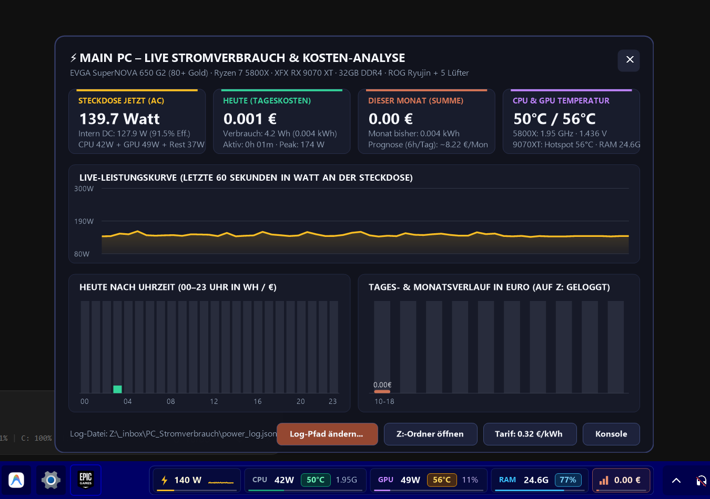

<div align="center">


# Win11 Taskbar Power & Telemetry HUD

**Ultra-lightweight native C++23 Windows 11 Taskbar live wall-power (`AC Watt`), CPU, GPU, RAM, and WiFi/Network (`MB/s` · `Mbit/s` · `GB/s`) telemetry HUD (`~12.8 MB RAM`, `0.0% Idle CPU`).**

[](https://github.com/EinMelih/win11-taskbar-power-hud/stargazers)
[](https://github.com/EinMelih/win11-taskbar-power-hud)
[](LICENSE)
[](src/taskbar-power-hud.wh.cpp)

</div>

---


---

## ⚡ Performance & Resource Footprint

Because the HUD is written in pure native Win32 C++ (`UpdateLayeredWindow` + GDI+ offscreen bitmap) without Electron, WebView2, or .NET runtime overhead, its resource consumption is practically zero:

| Metric | Measured Value | Details |
| :--- | :--- | :--- |
| **Private Memory (Task Manager RAM)** | **`~12.8 MB`** | `0.04%` of 32 GB RAM (Working Set incl. shared Windows system DLLs: `~30.9 MB`) |
| **CPU Usage (Idle / Normal)** | **`0.0 %`** (`< 0.03%`) | Top-3 process enumeration runs on-demand when hovering (`16 ms` UI timer only animates on hover; `1000 ms` sensor loop otherwise) |
| **GPU Usage** | **`0.0 %`** | Pre-multiplied ARGB DWM composition via `UpdateLayeredWindow` |
| **`Win + D` (*Show Desktop*) Delay** | **`0.000 ms`** | Anchored directly inside `Shell_TrayWnd` via `SetParent(hwnd, hTray)` — zero refresh or flicker |
| **Disk I/O** | **Once per 60s** | Appends a single JSON/CSV summary (`~45 bytes/min`) to the configured energy log |

---

## 🤖 Instant Setup via AI Agent (Copy & Paste Prompt)

Because this HUD reads hardware sensors directly from native driver interfaces (zero bloatware, no heavy background services), **every PC has slightly different CPU/GPU sensors** (e.g., AMD Ryzen SMU vs. Intel RAPL/HWiNFO, AMD Radeon `atiadlxx.dll` vs. NVIDIA `nvml.dll`, different PSU 80+ efficiency curves).

**You don't need to edit C++ code manually!** Simply clone this repository, open it in your AI coding assistant (**Antigravity, Cursor, Windsurf, Cline, Copilot, or ChatGPT**), and paste this prompt (your AI agent can also translate any UI labels/currency to your preferred language automatically):

```text
Please check compatibility and set up this Windows 11 Taskbar Power & Telemetry HUD for my PC:
1. Read `AGENTS.md` first and run the hardware diagnostic scanner: `powershell -ExecutionPolicy Bypass -File .\scripts\check_hardware_for_ai.ps1`.
2. Verify my CPU model/base clock, GPU vendor (`atiadlxx.dll` vs. `nvml.dll`), RAM size, display DPI, and installed compiler.
3. Adapt `ReadAllSensors()`, the CPU base clock, and (if desired) the UI language/currency in `src/taskbar-power-hud.wh.cpp` to match my exact hardware and language as documented in `AGENTS.md`.
4. Compile and install the HUD into my Windows 11 taskbar by running `.\scripts\build_and_install.ps1`.
```

---

## ✨ Features

* **🎨 Compact Minimalist Warm-Obsidian Dark UI:**
  * Compact Warm Obsidian (`#191918`) outer pill, graphite micro-cards (`#242321`), crisp off-white typography (`#F5F4EF`), and warm terracotta (`#D97757`) accents & sparklines.
* **⚡ Real-Time Wall Socket Power (`AC Watt`) & 60s Sparkline:**
  * Calculates true wall-outlet power (`AC Watt`) from `CPU Package Power (PPT) + GPU Total Board Power + Dynamic Rest-System (Motherboard/RAM/AIO/Fans/SSDs)` divided by your PSU's 80 PLUS efficiency curve.
* **🌐 Live WiFi / Network Throughput (`MB/s` · `Mbit/s` · `GB/s`):**
  * Polls real-time physical network throughput via Windows `GetIfTable2` (`iphlpapi.dll`), automatically filtering out virtual/loopback adapters.
  * Shows a clean WiFi icon + live throughput in the taskbar pill; hovering over or clicking the WiFi card opens a compact capsule showing separated `↓ Download` & `↑ Upload` speeds plus interactive **`[ MB/s ]  [ Mbit/s ]  [ GB/s ]`** unit selector pills (saved persistently in `power_config.json`).
* **🎯 1:1 Windows Task Manager GHz Sync:**
  * Queries `\Processor Information(_Total)\% Processor Performance` via `pdh.dll` so CPU clock speed matches the Windows 11 Task Manager to the second decimal (`e.g. 4.58 GHz`).
* **🌡️ Calibrated Temperature Badges & Throttling Detection:**
  * 🟢 **`<= 66.0 °C`:** Emerald Green (Optimal / 0% throttling)
  * 🟡 **`66.1 – 77.0 °C`:** Warm Gold (Normal Gaming Load)
  * 🟠 **`77.1 – 86.0 °C`:** Vivid Orange (Heavy Load)
  * 🔴 **`>= 86.1 °C`:** Ruby Red (Near `90°C TjMax` / Thermal Throttling Indicator `⚠️`)
* **🚀 60-FPS Minimalist Hover Capsules (`[Icon] + App Name + Live Data`):**
  * Hovering over **`CPU`**, **`GPU`**, **`RAM`**, or **`WiFi`** smoothly glides up a compact 3-row capsule displaying the **real Windows App Icon, clean Application Name, and live resource consumption** of your Top 3 active processes (or Download/Upload + Unit Switcher on the WiFi card):
    * **CPU Hover:** `[App Icon] App Name   4.3% · 3W`
    * **GPU Hover:** `[App Icon] App Name   612M · 0%`
    * **RAM Hover:** `[App Icon] App Name   3.49G · 11%`
    * **WiFi Hover:** `↓ Download / ↑ Upload` + clickable `[ MB/s ] [ Mbit/s ] [ GB/s ]` switcher
* **🛡️ 100% `Win + D` (*Show Desktop*) Immune (`0.000 ms` Flicker):**
  * Anchored directly inside `Shell_TrayWnd`'s DWM visual tree via `SetParent(hwnd, hTray)` on a `WS_POPUP | WS_EX_LAYERED` surface — Windows treats the HUD as part of the native taskbar itself, so `Win + D` never minimizes or refreshes it even for a millisecond.
* **📊 Interactive Click-Flyout Energy & Cost Dashboard:**
  * Left-clicking the taskbar pill opens the full analytics dashboard with a **60-second live wattage curve**, **24-hour (`00–23h`) bar chart**, **Daily & Monthly electricity cost progression chart**, and 1-click configuration for your custom log path (e.g. local disk or NAS/SMB drive `Z:\`) and electricity tariff (`€/kWh`).



---

## 📋 Prerequisites & Requirements

1. **Operating System:** Windows 11 (`22H2` / `23H2` / `24H2` / `25H2`) with space on the right side of the taskbar (left of the system tray `TrayNotifyWnd`).
2. **Compiler (for building from source):**
   * **Recommended:** [Windhawk](https://windhawk.net/) (`winget install RamenSoftware.Windhawk`) — includes a ready-to-use `clang++.exe` toolchain in `C:\Program Files\Windhawk\Compiler\bin\clang++.exe` and allows running the HUD either as a native Windhawk Mod or Standalone EXE.
   * **Alternative:** Any `x86_64-w64-mingw32` / LLVM `clang++` toolchain.
3. **Hardware Telemetry Interfaces (Native Out-of-the-Box vs. AI-Adaptable):**
   * **CPU Clock & Utilization + Per-App CPU/GPU/RAM:** Uses native Windows `pdh.dll`, `psapi.dll`, and `shell32.dll` — **works on 100% of Windows 11 PCs out of the box**.
   * **CPU Wattage & Temperature:**
     * *Out of the box:* **AMD Ryzen CPUs** via AMD Ryzen Master SDK Shared Memory (`Local\954b280e-5529-4492-bab2-bb7a502552f8` provided by `CPUMetricsServer.exe` / AMD Chipset Drivers).
     * *Via AI Adaptation (`AGENTS.md`):* Intel Core CPUs (via LibreHardwareMonitor / HWiNFO Shared Memory or TDP-Load curve).
   * **GPU Wattage & Temperature:**
     * *Out of the box:* **AMD Radeon GPUs** via native `atiadlxx.dll` (`ADL2_New_QueryPMLogData_Get`).
     * *Via AI Adaptation (`AGENTS.md`):* **NVIDIA GeForce RTX/GTX GPUs** via native `nvml.dll` (`nvmlDeviceGetPowerUsage` / `nvmlDeviceGetTemperature`).

---

## 🛠️ Manual Build & Installation

```powershell
# 1. Check your hardware & sensor availability
powershell -ExecutionPolicy Bypass -File .\scripts\check_hardware_for_ai.ps1

# 2. Compile TaskbarPowerHud.exe & register Windows Logon Autostart
powershell -ExecutionPolicy Bypass -File .\scripts\build_and_install.ps1
```

---

## Contact & Maintainer

Created by **[@EinMelih](https://github.com/EinMelih)**.

- If you find the code useful, feel free to leave a ⭐ on the repo: [**Star `EinMelih/win11-taskbar-power-hud` on GitHub**](https://github.com/EinMelih/win11-taskbar-power-hud/stargazers).
- For questions, hardware sensor additions, or Pull Requests, open an [Issue](https://github.com/EinMelih/win11-taskbar-power-hud/issues) or reach out via my GitHub profile **[@EinMelih](https://github.com/EinMelih)**.

---

## 📄 License

Released under the [MIT License](LICENSE).
